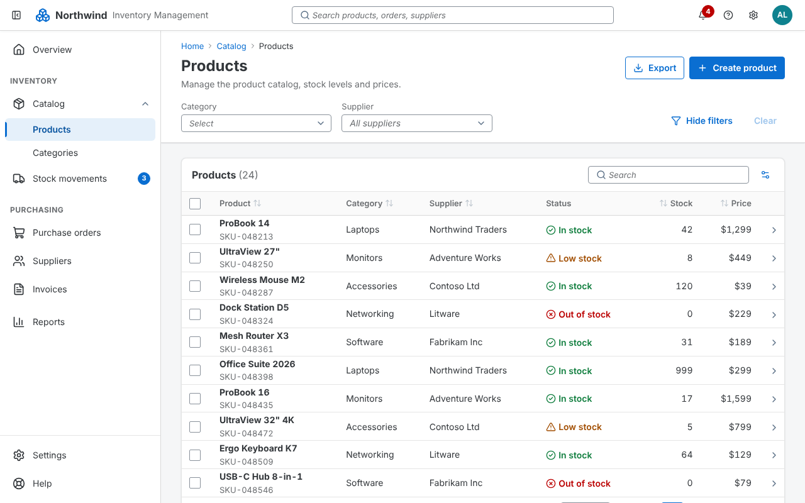
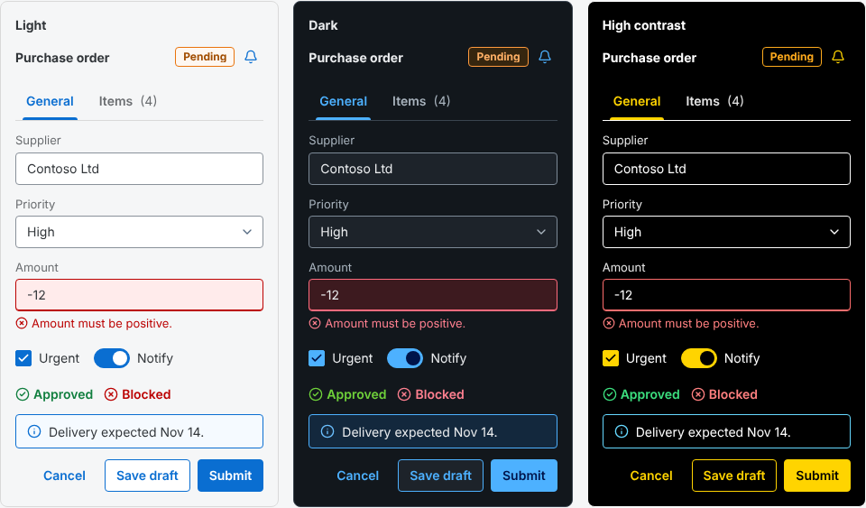
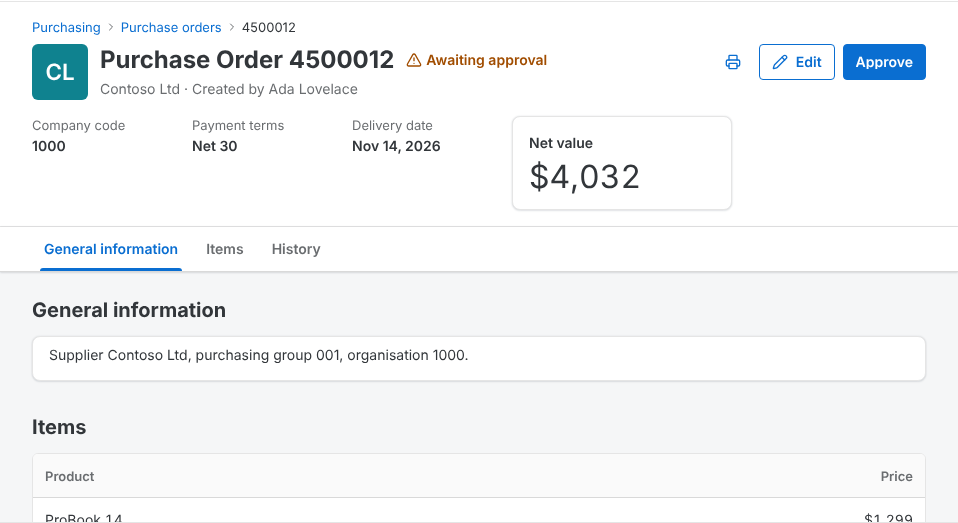
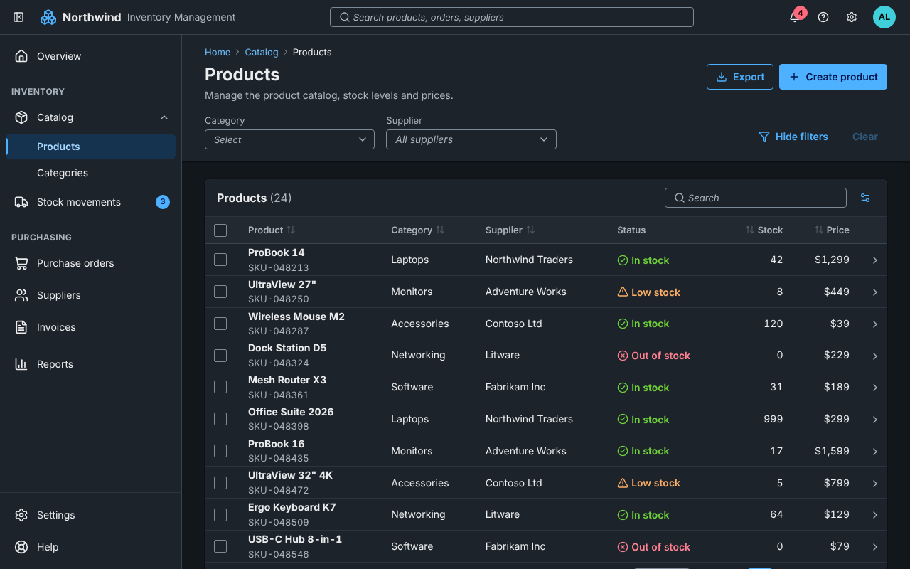
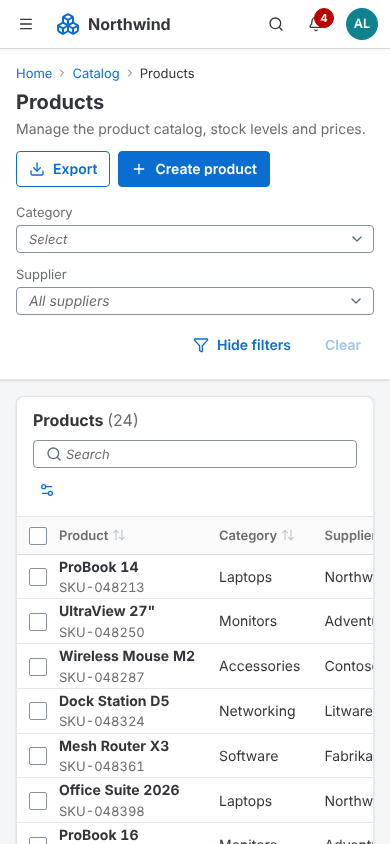
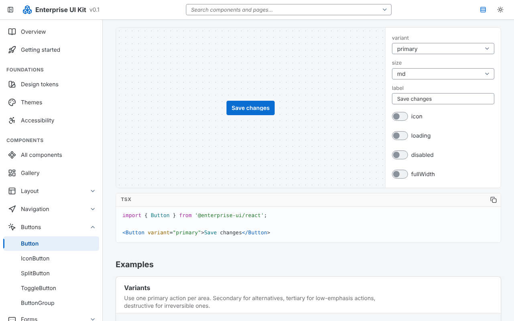

# Enterprise UI Kit

A React + TypeScript component library for building business applications that look and behave like modern SAP Fiori software, without depending on SAPUI5.

`@enterprise-ui/react` is meant for dashboards, admin panels, ERP, inventory, fleet management and other data-heavy screens. It has its own implementation, design tokens and component APIs. It uses only one runtime dependency, `lucide-react`, for icons.



**[Documentation and live demo →](https://iant89.github.io/ENTERPRISE-UI/)**

> **Status: 0.1, pre-release.** The package is not on npm yet. See [Installation](#installation) for using it from this repository.

See the [development roadmap](https://github.com/iant89/ENTERPRISE-UI/blob/main/ROADMAP.md), [enterprise cookbook](https://github.com/iant89/ENTERPRISE-UI/blob/main/docs/enterprise-cookbook.md), [release-quality guide](https://github.com/iant89/ENTERPRISE-UI/blob/main/docs/release-quality.md), and [localization audit](https://github.com/iant89/ENTERPRISE-UI/blob/main/docs/localization-audit.md).

## Features

- **Documented components and patterns.** Layout, navigation, buttons, forms, data display and feedback, plus enterprise patterns:
  - FilterBar
  - ObjectPage
  - MasterDetail
  - Wizard
  - Dashboard
  - and more
- **Design tokens.** Every color, spacing, type, radius, shadow, size, z-index, motion and density value is a CSS custom property (`--eui-*`).
- **Themes.** Light, dark and high contrast, plus cozy and compact density. Switch them at runtime, or scope one to any part of the page.
- **Accessibility.** Targets WCAG 2.2 AA, with semantic HTML, WAI-ARIA keyboard patterns, focus trapping and restoration, live announcements and reduced motion.
- **Responsive.** Works on desktop, tablet and phone. The navigation becomes a drawer on small screens, and tables can stack into cards.
- **Typed and tree-shakeable.** Strict TypeScript APIs and one ES module per component. React is a peer dependency, and the stylesheet is imported separately.

## Screenshots

**Light, dark and high-contrast themes, plus SAP Morning Horizon, Evening Horizon, Quartz Light and Quartz Dark**



**Object page pattern**



**Dark theme and phone layout**

<p>
  
  
</p>

**Documentation: interactive preview with generated code**



## Requirements

- React and React DOM 18.2 or newer (React 19 supported)
- Node.js 20.19+ (20.x) or 22.12+ to build or develop the library (as required by Vite 8)

## Installation

Until the package is published, build a tarball from this repository and install it into your app:

```bash
git clone https://github.com/iant89/ENTERPRISE-UI.git
cd ENTERPRISE-UI
npm install
npm run build:lib
npm pack                      # creates enterprise-ui-react-0.1.0.tgz

# in your application
npm install /path/to/enterprise-ui-react-0.1.0.tgz lucide-react
```

Once it is published, this becomes:

```bash
npm install @enterprise-ui/react lucide-react
```

## Quick start

Import the stylesheet once and wrap your app in `ThemeProvider`:

```tsx
// main.tsx
import { createRoot } from 'react-dom/client';
import { ThemeProvider, ToastProvider } from '@enterprise-ui/react';
import '@enterprise-ui/react/styles.css';
import { App } from './App';

createRoot(document.getElementById('root')!).render(
  <ThemeProvider theme="light" density="cozy" style={{ minHeight: '100vh' }}>
    <ToastProvider>
      <App />
    </ToastProvider>
  </ThemeProvider>,
);
```

Then use the components:

```tsx
import { Button, Card } from '@enterprise-ui/react';

export function Dashboard() {
  return (
    <Card title="Sales Overview">
      <p>Total revenue: $125,430</p>
      <Button variant="primary" onClick={() => console.log('Opening report')}>
        View Report
      </Button>
    </Card>
  );
}
```

`ThemeProvider` does three things:

- applies the theme and density;
- hosts the layer that menus, popovers and dialogs render into, so they pick up the theme;
- provides the screen-reader live region used by toasts and `useAnnouncer()`.

`ToastProvider` is only needed if you use toasts.

## Usage

### Forms and validation

Every form control takes `label`, `description`, `error` and `required`. The component connects the label, helper text and error message to the input for screen readers.

```tsx
import { useState } from 'react';
import { DatePicker, Input, Select } from '@enterprise-ui/react';

function SupplierForm() {
  const [country, setCountry] = useState<string | null>(null);
  return (
    <>
      <Input label="Supplier name" required error="Enter a supplier name." />
      <Select
        label="Country"
        value={country}
        onChange={setCountry}
        options={[
          { value: 'de', label: 'Germany' },
          { value: 'fr', label: 'France' },
        ]}
      />
      <DatePicker label="Contract start" description="Format: YYYY-MM-DD" />
    </>
  );
}
```

Components are controlled when you pass `value`, `checked` or `open`. Without them, they manage their own state, starting from the `default*` prop.

### Application shell

```tsx
import { Home, Package } from 'lucide-react';
import { AppShell, ApplicationHeader, Button, NavigationItem, Page, SideNavigation } from '@enterprise-ui/react';

<AppShell
  header={<ApplicationHeader productName="Northwind" user={{ name: 'Ada Lovelace' }} notificationCount={3} />}
  navigation={
    <SideNavigation
      activeId="products"
      onNavigate={(id, event) => {
        event.preventDefault(); // hand routing to your router
        router.push(id);
      }}
    >
      <NavigationItem id="home" label="Home" icon={<Home />} href="/" />
      <NavigationItem id="catalog" label="Catalog" icon={<Package />}>
        <NavigationItem id="products" label="Products" href="/products" />
      </NavigationItem>
    </SideNavigation>
  }
>
  <Page
    title="Products"
    breadcrumbs={[{ label: 'Home', href: '/' }, { label: 'Products' }]}
    actions={<Button variant="primary">Create</Button>}
  >
    …
  </Page>
</AppShell>
```

The navigation adapts to the screen width:

| Screen | Width | Navigation |
| --- | --- | --- |
| Phone | under 600px | Modal drawer |
| Tablet | 600–1023px | Collapsed to icons |
| Desktop | 1024px and up | Full width; the user can collapse it |

The shell also renders a "Skip to main content" link.

### Themes and density

```tsx
<ThemeProvider theme="system">…</ThemeProvider>   {/* follows the OS: light, dark or increased contrast */}
<ThemeProvider theme="dark" density="compact">…</ThemeProvider>
```

Read the current theme and density with `useTheme()`. To apply your brand colors, override the tokens on a themed element:

```css
[data-eui-theme='light'].my-brand {
  --eui-color-primary: #1b5e20;
  --eui-color-primary-hover: #134a17;
  --eui-color-focus: #1b5e20;
}
```

When you override colors, keep text at 4.5:1 contrast or better, and borders and focus rings at 3:1. Run `node scripts/contrast.mjs` to check the built-in themes.

### Tokens without components

```css
@import '@enterprise-ui/react/tokens.css';

.panel {
  padding: var(--eui-space-4);
  border: 1px solid var(--eui-color-border);
  border-radius: var(--eui-radius-md);
}
```

## Components

| Category | Components |
| --- | --- |
| Layout | AppShell, Page, Container, Grid, Flex, Stack, SplitView, ResizablePanel |
| Navigation | ApplicationHeader, SideNavigation, NavigationItem, NavigationGroup, Breadcrumbs, Tabs, Menu, DropdownMenu, Pagination |
| Buttons | Button, IconButton, SplitButton, ToggleButton, ButtonGroup |
| Forms | Input, TextArea, NumberInput, SearchField, Select, ComboBox, MultiSelect, Checkbox, RadioGroup, Switch, DatePicker, Calendar, TimePicker, FormField, FormGroup |
| Data display | Table, DataGrid, List, Tree, TreeTable, Card, Avatar, Badge, StatusIndicator, Timeline, ObjectIdentifier, MetricCard |
| Feedback | Dialog, AlertDialog, Toast (`ToastProvider` + `useToast`), MessageStrip, Tooltip, Popover, ProgressBar, Spinner, Skeleton |
| Enterprise patterns | FilterBar, MasterDetail, ObjectPage, DetailPanel, Wizard, Dashboard, CommandToolbar, EmptyState |

The library also exports these hooks:

- `useControllableState`
- `useFocusTrap`
- `usePosition`
- `useMediaQuery`
- `useBreakpoint`
- `useTheme`
- `useAnnouncer`
- `useToast`
- `useAppShell`

It also exports the token catalogue: `tokenGroups`, `getTokenValue` and `breakpoints`.

The patterns are built from the other components rather than re-implementing them. For example, `DataGrid` is `Table` + `SearchField` + `Select` + `Pagination` + `DropdownMenu`.

## Documentation

The documentation is published at **https://iant89.github.io/ENTERPRISE-UI/**, and the demo app is at [`#/demo`](https://iant89.github.io/ENTERPRISE-UI/#/demo). The `Deploy documentation to GitHub Pages` workflow (`.github/workflows/pages.yml`) rebuilds and deploys the site on every push to `main`; you can also run it manually from the Actions tab.

To run it locally:

```bash
npm install
npm run dev        # http://localhost:5173
```

The documentation site is built with the library itself. It covers:

- Overview
- Getting started
- Design tokens (with live values)
- Themes
- Component gallery
- Layouts
- Enterprise patterns
- Accessibility
- API reference

Each of the 64 component pages has:

- a live preview, with interactive controls where useful;
- TypeScript examples, including disabled and error states;
- a table of props and their defaults, generated from the source;
- the keyboard model;
- accessibility notes.

Open `#/demo` to see a complete inventory application built only from library components.

## Development

```
src/
  components/   one folder per component: Component.tsx, *.module.css, *.test.tsx, index.ts
  layouts/      AppShell, Page, Grid, SplitView, …
  patterns/     FilterBar, ObjectPage, Wizard, …
  hooks/  themes/  tokens/  utilities/  styles/
  index.ts      public API
docs/           documentation site (Vite app)
examples/       example components, rendered live and shown as code by the docs
tests/          test setup, example tests, Playwright suites
scripts/        API extraction, contrast checker, build helpers
```

| Command | What it does |
| --- | --- |
| `npm run dev` | Starts the documentation site |
| `npm test` | Runs unit, behavior and accessibility tests (Vitest, Testing Library, axe-core) |
| `npm run test:e2e` | Builds the docs and runs the Playwright tests (described below) |
| `npm run test:e2e:update` | Refreshes the visual-regression baselines |
| `npm run check` | Runs the type check, lint and unit tests |
| `npm run build:lib` | Builds the library into `dist/`: ESM modules, `.d.ts` files, `styles.css` and `tokens.css` |
| `npm run build:docs` | Builds the static documentation into `docs-dist/` |
| `npm run docs:screenshots` | Regenerates the README screenshots (needs the docs preview running on port 4173) |

The Playwright tests cover:

- axe accessibility checks on every docs page, in all three themes;
- keyboard flows;
- desktop and phone layouts;
- visual regression.

Styling uses CSS Modules. Class names are stable and readable, in the form `eui-<File>-<class>` (for example, `eui-Button-primary`). Every value comes from a token. Base styles apply only inside `[data-eui-theme]`, so the library never resets your app's global CSS.

## Contributing

To add a component:

1. Create `src/components/<name>/` with the component, a `.module.css` file that uses only `--eui-*` tokens, an `index.ts` and a test.
2. Document every prop with JSDoc, including `@default` where there is one. The API reference is generated from these comments.
3. Export the component from `src/index.ts`.
4. Add a docs entry in `docs/src/registry.ts`, with a summary, keyboard model and accessibility notes.
5. Add one or more examples in `examples/<slug>/`. The test suite renders each example and checks it with axe.
6. Run `npm run check` and `npm run test:e2e` before opening a pull request.

CI (`.github/workflows/ci.yml`) runs the type check, lint, contrast check, unit tests, library build and Playwright suite. Visual-regression baselines depend on the platform's fonts, so CI skips them unless `VISUAL_BASELINES=1` is set and the baselines were generated in the CI image.

## Known limitations

- `DataGrid` filters, sorts and paginates on the client only. It has no row virtualization and no server-side data hooks yet.
- Right-to-left layout is only partly supported. Tabs reverse their arrow keys in RTL, but the layouts have not been audited for RTL.
- The SAP "72" font is not bundled. Text falls back to Segoe UI, then Arial.
- The automated browser tests run in Chromium only. The library targets current versions of Chrome, Edge, Firefox and Safari.

## License

No license has been chosen yet. Until one is added, all rights are reserved by the repository owner.

## Third-party content

- SAP Fiori themes (`sap-horizon`, `sap-horizon-dark`, `sap-fiori-3`, `sap-fiori-3-dark`) are generated from
  [`@sap-theming/theming-base-content`](https://github.com/SAP/theming-base-content), © SAP SE or an SAP affiliate company,
  Apache-2.0, including the bundled 72 font (`@enterprise-ui/react/sap-fonts.css`). See `src/themes/SAP-THEMES.md`, `src/themes/fonts/README.md` and `src/themes/SAP-THEMING-BASE-CONTENT-LICENSE.txt`.
- The barcode decoder vendors ZXing (`vendor/zxing-library`, Apache-2.0); see `vendor/README.md`.
